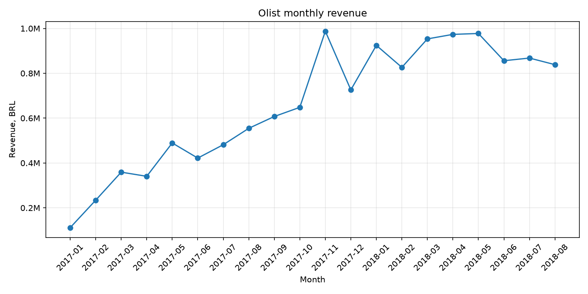
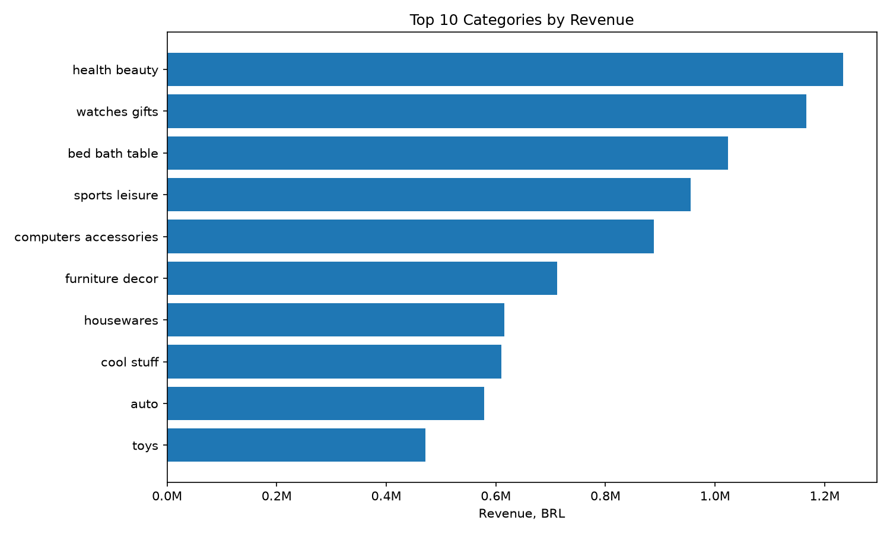
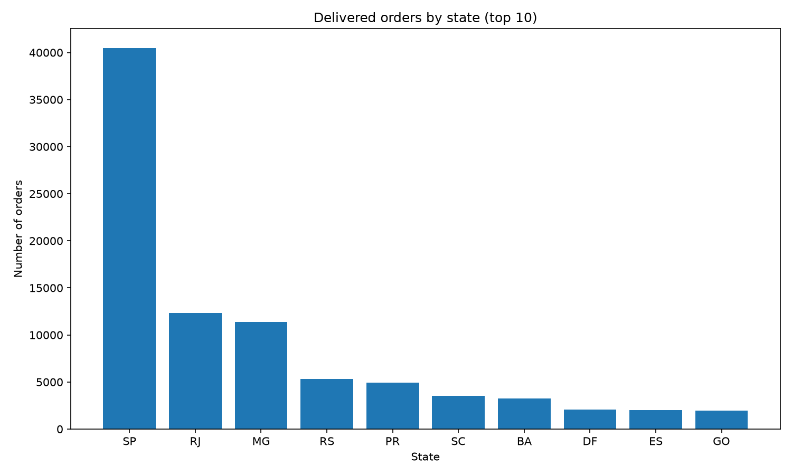

# Olist sales analysis

This project analyzes the Brazilian e-commerce dataset by Olist (~100k orders, 2016–2018) with SQL and pandas, covering revenue, product categories, delivery time and repeat customers.

## Questions

1. How does monthly revenue change between 2017-01 and 2018-08?
2. Which product categories bring the most revenue?
3. What is the average order value for delivered orders?
4. How long does delivery take, and what share of orders arrives late?
5. How many customers place more than one order?
6. Which states generate the most orders?

## Key findings

- Average order value: 137.04 BRL (delivered orders, item price only, freight excluded)
- Average delivery time: 12.6 days, late orders: 6.8% (from purchase to delivery)
- Repeat customers: 3.0% (2,801 of 93,358 customers with delivered orders placed more than one order)
- Top 3 categories by revenue: health_beauty, watches_gifts, bed_bath_table
- Most orders come from the state of São Paulo: 40,501 orders (about 42% of all delivered orders) 
- Peak monthly revenue: November 2017 (987,765.37 BRL)
- Biggest month-over-month growth: +52.4% in November 2017, biggest drop: -26.5% in December 2017

## Charts





## Data notes

- `customer_id` is created per order, so unique customers are counted by `customer_unique_id`
- Why the revenue chart covers only 2017-01 to 2018-08: data at the start and end is incomplete
- How "late" is defined: delivered date is later than the estimated date, compared by day
- Revenue is calculated from `price` only, freight is excluded; only `delivered` orders are used
- The `customers` table has 99,441 unique `customer_id` values (one per order) but only 96,096 unique `customer_unique_id` values (real people), so customers are counted by `customer_unique_id`. The 93,358 in "Key findings" counts only customers with delivered orders. See `checks.py`.

## Project structure

- `load_to_sqlite.py` loads the CSV files into `olist.db`
- `explore.py` quick overview of every table
- `sql/` SQL queries (`01_basics.sql`, `02_sales.sql`, `03_delivery_and_customers.sql`, `04_window_functions.sql`)
- `analysis.py` builds the charts in `images/`
- `checks.py` checks that `customer_id` is not a unique person (see Data notes)

## How to run

1. Download the dataset from Kaggle: [link to the Olist dataset](https://www.kaggle.com/datasets/olistbr/brazilian-ecommerce) and put the CSV files into a `data/` folder.
2. Install dependencies:
```
   pip install -r requirements.txt
```
3. Create the database:
```
   python load_to_sqlite.py
```
4. Build the charts:
```
   python analysis.py
```

## Tools

Python, pandas, matplotlib, SQLite

## Data source

Olist Brazilian E-Commerce Public Dataset, published by Olist on Kaggle:
https://www.kaggle.com/datasets/olistbr/brazilian-ecommerce

The dataset is licensed under CC BY-NC-SA 4.0:
https://creativecommons.org/licenses/by-nc-sa/4.0/

Changes made: the CSV files were loaded into SQLite, filtered to delivered orders where stated, and aggregated for the analysis. The original data files are not included in this repository.